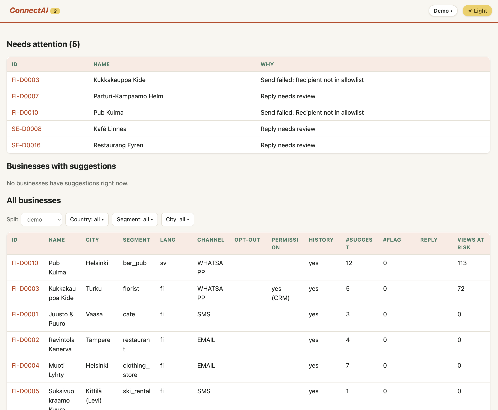

# Justo Puuronen – ConnectAI

An owner contact loop for Fonecta Connect: **detect** wrong holiday hours, **suggest** fixes, **contact** the owner on
their preferred channel (email, WhatsApp, simulated SMS), let them **decide** with no login (reply or tap a button),
then **apply** the change to Yext and **confirm** on the same channel. Built for the Since AI Hackathon 2026 × Fonecta.
All data is synthetic (the kit's).



## Context

Challenge: Connect Suggests – Customer Approves (Since AI Hackathon 2026 × Fonecta, 6–8 Nov 2026, Turku). The kit's own
description is in `START_HERE.md`; its data dictionary, demo storylines and mock API docs are in `docs/` and `mock_api/`.
**All data is synthetic**: no real businesses, customers or Fonecta data. Licence: kit code MIT, data CC BY 4.0, © 2026 Since AI ry.

Two things worth knowing that are specific to how we use the kit:

- The Yext mock runs embedded in our app, so `make dev` needs no second process. Our app uses `YEXT_MODE=http` with
  `YEXT_BASE_URL`, plus the separate `YEXT_SANDBOX_*` settings described under "Bonus: live source". Never commit keys.
- The Yext sandbox has the same API but not the same data: its test businesses have no exception-hour history, so we use the
  mock for detection and the sandbox to demo the write path.
- About 40 % of needed changes have no usable history; that is where reviews, peers, the pilot log, events and weather earn
  points. See "Customer with no history / no previous actions" below.

## Submission checklist and rules

Submit in the Since AI app by the event deadline. `docs/README_TEMPLATE.md` (kit) is the README template; this file covers it.

| Requirement | Where it is |
|---|---|
| Working demo of the five steps (live or a 2–3 min video) plus a short pitch deck | local demo (`cd connect-ai && make dev`); video and deck **not made yet** |
| Code repository with a README: how to run, data sources, third-party libraries and licences | "Run it", "Data sources that mattered most", "Third-party code, data and licences" |
| The 3–5 data sources that matter most, their production source, and what did not work | "Data sources that mattered most", "What we tried that didn't work" |
| Final customer messages as text | "Final customer messages" and `connect-ai/docs/MESSAGES.md` |
| Behaviour for a customer with no history / no previous actions | "Customer with no history / no previous actions" |
| Bonus: replace a dataset file with a live source and report what we learned | "Bonus: live source" (report still to write) |
| Optional: `predictions_2026.csv` in the repository root | `python -m scripts.export_predictions` writes it; from `connect-ai/`, check with `python ../evaluation/evaluate.py --predictions ../predictions_2026.csv`. Organisers score the **test** rows; rows left out count as `NO_ACTION`, and dev rows stay in the file |

Rules: synthetic data only, nothing real uploaded. Fonecta's sandbox credentials stay out of repos and videos. Back-test
honestly: when simulating 6 Nov 2025, use only rows with timestamps before it. List third-party code/data and licences in the
README. No GPL/AGPL components without Fonecta's written approval.

## Run it

No cloud account is needed locally: memory store, fake mail, fake LLM, and the kit's Yext mock runs inside the app.

```bash
cd connect-ai
make setup dev                      # http://localhost:8080  (Python 3.12+; the kit sits in the parent folder)
make lint test                      # 270+ test functions, no network; includes "kit files are byte-identical to MANIFEST.json"
python -m scripts.export_predictions && python ../evaluation/evaluate.py --predictions ../predictions_2026.csv
```

HTMX 2 (0BSD) is vendored in `connect-ai/app/server/static/htmx.min.js`. Other make targets: `make test-fast` (skips the slower kit-mock
integration tests), `make fmt`, `make eval` (parser eval, needs `LLM_MODE=vertex`), `make messages` (regenerates `connect-ai/docs/MESSAGES.md`).

Demo walk-through (local): **Businesses** → open a business card (the 17 demo businesses are listed first) → **Create message**
(the app picks the template: event, holidays or stale hours; if nothing qualifies the card shows why it stays quiet) →
**Send message** → in the demo sidebar on the right: **Simulate owner**, or **Write a reply…**, or tap the fake WhatsApp
buttons / reply in the **Phone** page (**Outbox** shows sent mail) → see the new hours on the business card → **Revert**.
The sidebar's **demo clock** (+5 h, +24 h) shows the WhatsApp → email reminder → permission-request chain. **All replies**
lists every reply, and the ones that need review can be applied or rejected there or on the card.

**Keys:** none locally. Optional local config goes in `.env` (gitignored; copy `.env.example`). In staging every secret
lives in **GCP Secret Manager**: `token-hmac-key`, `gmail-client-id`, `gmail-client-secret`, `gmail-refresh-token`,
`wa-access-token`, `wa-app-secret`, `wa-verify-token`, `yext-api-key` (optional). Nothing secret is in the repo.

### Staging (GCP, Cloud Run)

The app has real adapters for Firestore, Gmail, Vertex AI and Meta WhatsApp, selected with `STORE_MODE=firestore`,
`MAIL_MODE=gmail`, `LLM_MODE=vertex`, `WA_MODE=meta` (plus `GCP_PROJECT_ID`, and `SERVICE_ROLE=web|inbound|webhooks`). They are
tested against fakes only. **The deploy scripts (`Dockerfile`, `infra/setup.sh`, `infra/deploy.sh`,
`infra/env.staging.example.yaml`) are not in this folder at the moment**, so deployment is not reproducible from this
repository until they are restored.

Intended services: `connect-web` (people, behind IAP, or private + `gcloud run services proxy`),
`connect-inbound` (private; Pub/Sub + Scheduler: `/pubsub/gmail`, `/cron/*`), `connect-webhooks` (the only public one: rejects every
request without a valid Meta HMAC signature), `yext-mock` (private, one instance, state in memory). The image should contain the
kit's `mock_api`, `examples`, `data` and `evaluation` but **not** `labels/` (runtime never reads answers).
**Budget guard:** create a billing budget alert at 50 % and 90 % of the credits (Billing → Budgets & alerts).
**Wipe staging:** `python -m scripts.wipe_staging` (asks you to type the project id).
**Retention:** reply text is kept 90 days (Firestore TTL on `replies.expire_at`).

## The five steps

1. **Detect** – `DetectorV2` (`app/detect/`, the default `SUGGESTIONS_MODE=v2`): a small model trained on the dev labels
   (`scripts/train_detector.py`, shipped as `model.json`) over the kit baseline's signals (last year, the owner's own previous
   edits, shopping centre, peers, reviews). Event and school-break rows stay with the baseline. Overrides measured on the dev
   labels: a date that already has an entry is left alone (96 % are correct), and event nights use the business's own event
   history. Each suggestion carries a reason line. Businesses whose reviews or Google edits say "closed for good" are
   **flagged**, never messaged. `SUGGESTIONS_MODE=baseline` gives the plain rules.
2. **Suggest** – code builds every fact (dates, hours, reasons); an LLM only writes the subject and a 2–4 sentence intro in the
   owner's language (fi/sv/nb/en), validated and with a deterministic fallback.
3. **Contact** – on the preferred channel: email (signed token in the `Reply-To`), WhatsApp (approved templates with
   Approve / Edit / No thanks buttons carrying a signed token), or simulated SMS. Sorted so the businesses with the most
   at-risk Google views are contacted first; silence when there is no evidence.
4. **Decide** – no login. An LLM parses the reply (or a button tap decides directly) into approve / decline / per-date edit,
   which is validated; it auto-applies only if the sender, authentication, token, confidence and uniqueness checks all pass,
   otherwise it goes to the review queue.
5. **Apply + confirm** – a read-modify-write of the full Yext hours object (audited, revertible), then a confirmation on the
   same channel in the owner's language with publisher names and the expected go-live time from Yext listings.

No answer? WhatsApp/SMS → reminder email after twice the usual answering time (never before 4 h, only inside the owner's
contact window) → one honest permission request ("may we update holiday hours automatically?") with last year's real Google
numbers. A "yes" is stored with the owner's own words as consent evidence; later campaigns for that business only inform.

## Data sources that mattered most

Measured on the 802 dev businesses (labels used offline only, never at runtime):

| Signal | How we used it | Measured | Where Connect would get it in production |
|---|---|---|---|
| Last year's holiday entry (`holiday_hours_history`) | Copy last year's hours when this year has no entry | 2200 suggestions, 94 % exact | Connect's own audit log of what each owner entered |
| Peer benchmarks (`peer_benchmarks`) | "Most similar businesses nearby are closed that day" | 912 suggestions, 87 % exact; also the evidence for asking new customers | Aggregates over Connect's customer base |
| Shopping-centre hours (mall entity in Yext) | Use the mall's published hours | 405 suggestions, 84 % exact | Yext Knowledge Graph (parent/mall entity) |
| Event-night history + local events | Suggest the business's usual hours on event nights | 25 suggestions, 68 % needed a change, 40 % exact hours; the plain baseline makes none | Connect audit log + a live events feed (e.g. LinkedEvents) |
| Analytics (`analytics_daily`: Google search/map views) | Ranking: who to contact first; "seen N times last year" line | Spearman 0.945 vs true at-risk views; top 20 % of businesses hold 55 % of them | Yext Analytics reports |
| Reviews and Google user edits | FLAG "closed for good"; evidence that regular hours are stale | Stale-hours precision 0.60 (review wording: 10 of 11 right) | Yext Reviews, Yext Publisher Suggestions |

Detection score on the dev labels (`python -m scripts.eval_detector --v2`; 2026 = mean of two entity folds, the model trained
on the other fold): kit baseline **54.50**, DetectorV2 **55.41** (precision 0.899, recall 0.601, 114 harmful suggestions). The 2025
back-test (data before 2025-11-06 only) gives 53.23 vs **54.14**. The shipped `model.json` is trained on all dev entities, so
`predictions_2026.csv` scores **55.77** in-sample (baseline 54.6; harmful 218 vs 226). Without the model (rules only,
`python -m scripts.eval_detector`) the score is 54.6 (precision 0.898, recall 0.592, search views protected 57.5 %,
closed-door views prevented 69.2 %). Honestly: the gain is about one point, and V2 makes 2 (2026) to 5 (back-test) more
*harmful* suggestions than the baseline, which misses our own "not higher" target; raising the harm penalty further lowered
the score below the baseline. The bigger effect is on *who we contact* and *how*, plus learning from the owner's own decisions
(next section).

Who we contact (`python -m scripts.eval_quiet`): holidays precision 0.95 (same as the baseline: its misses are not "needless"
messages), event messages precision 0.68 / recall 0.81 where the baseline sends none, stale-hours precision 0.60 / recall 0.55.
Findability (`python -m scripts.eval_priority`): with 25 messages a day, priority order reaches 60 % of the at-risk views in a
week versus 23 % in file order.

## How it learns from the owner

`app/core/learning.py` (pure) + `app/server/services/learning.py` (memory). Every applied reply stores, per owner and holiday,
what they did; the 2025 pilot log (`data/pilot_decision_log_2025.csv`, 761 businesses) seeds the memory (`LEARN_FROM_PILOT`).
For the same holiday in a later year: **edited** → suggest their hours (reason "You set these hours last time"); **approved**
→ suggest the same hours; **declined** → never suggest those exact hours again (a different suggestion still goes out).
Measured with `python -m scripts.eval_learning` (2025 pilot → 2026 dev labels): approved hours are the 2026 truth 97 % of
the time (n = 326), edited hours 77 % (n = 26), declined hours were not the truth 93 % (n = 28). Standing permission
 is the last step of the ladder. Production counterpart: Connect's audit log of owner decisions.

## What we tried that didn't work

- **Google publisher suggestions as "your regular hours are stale" evidence.** Suggestions that only add `holidayHours` were
  right 1 time in 25, weekday ones 4 in 11. Using all of them gave stale-hours precision 0.27; keeping only weekday ones plus
  review wording lifted it to 0.60.
- **Event-night suggestions have poor exact hours** (40 % exact even where a change is needed 68 % of the time), so event
  messages ask the owner to confirm rather than claim to know.
- **A harsher penalty for wrong open/closed suggestions in the detector.** `HARM_EXTRA` 2.25 or more cut harmful suggestions
  to 97 but lowered the score to 53.4, below the baseline; 4.0 collapsed the 2025 back-test. We kept the best-scoring setting.
- **Pilot decisions and snow as extra detector signals** were not added: the 2025 pilot did not exist at the 2025 back-test
  snapshot, so it cannot improve that evaluation.

## Reply parsing (LLM) accuracy

`make eval` (`scripts/eval_parser.py`, `evals/replies.jsonl` plus simulator replies; run with `LLM_MODE=vertex`) on Vertex,
single run, 2026-11-07, location `global`: `gemini-3.1-flash-lite` intent **94 %** (33 cases), per-date **97 %** (131),
injection attempts auto-applied **0 of 4**. `gemini-3-flash-preview`: per-date 99 %, injections 0 of 4. The simulator writes
replies at temperature 1.0, so expect a point or two of run-to-run variance. Set the model with `LLM_MODEL` and
`VERTEX_LOCATION` (the code default is a placeholder: `gemini-2.5-*` returned 404 for our project in every region we tried).
Per-case results go to `outputs/eval_<model>.csv`.

## Customer with no history / no previous actions

`FI-D0017` Kahvila Kipinä has never entered holiday hours, so the baseline has nothing to copy. We do **not** send a generic
blast. We message only because peers give a reason: for Christmas Day and New Year's Day, most similar cafés in the same city
tier are closed, so those two get a suggestion ("closed") with that reason. For Christmas Eve, where peers are uncertain
(98 % of similar cafés that entered anything changed their hours, but not in one clear direction), we **ask** — "What are your hours that day?" — instead of
guessing. Ask items exist only for a new customer, on a major day, with enough peer evidence (≥ 30 % changed, ≥ 10 peers).
The same business is skipped entirely when there is no reason (FI-D0013 already entered its hours; NO-D0015 is open 24/7).

## Final customer messages (as text)

All messages in all four languages, the inform and permission messages, WhatsApp and SMS texts, and the approve / decline /
stopped follow-ups are in [`connect-ai/docs/MESSAGES.md`](connect-ai/docs/MESSAGES.md) (generated: `make messages`). One example (Finnish, the
approve follow-up with publisher ETAs):

```text
Kiitos Maria! Olemme päivittäneet aukioloaikanne:
• torstai 24.12.: kiinni
• torstai 31.12.: 10–14

Uudet ajat näkyvät seuraavissa palveluissa:
  Google-haku ja Google Maps – noin 2 min kuluttua
  Finder.fi / Fonecta.fi – noin 10 min kuluttua
  Apple Maps – noin 2 vuorokauden kuluttua
```

## Bonus: live source

The Yext write path can mirror every holiday-hours change to a **Yext sandbox** entity (`YEXT_SANDBOX_MIRROR`; a sandbox failure
never fails the real flow and is shown in the UI). **Direct mode** (`YEXT_SANDBOX_DIRECT=true`, entities mapped in
`YEXT_SANDBOX_ENTITY_MAP`, e.g. `FI-D0001=SinceAI14`) reads and writes those entities in the real sandbox while every other
business stays on the mock; `python -m scripts.sandbox_demo seed|restore` sets and restores the demo state (snapshot in the
git-ignored `outputs/`). Findings so far: the sandbox has the same API as the mock but different data (no exception-hour
history, a Fonecta category scheme `P####` with no mapping from the kit's taxonomy, so categories are never written, and
kit-only fields such as `c_segment` are kept in memory and never sent). Still open: clearing `hours` on restore sends `null`
and is untested against the sandbox. The coverage / quality / gaps write-up that `docs/LIVE_SOURCES.md` asks for has not
been written yet (the planned `docs/LIVE_SOURCE_REPORT.md` does not exist).

## Third-party code, data and licences

| Component | Licence |
|---|---|
| Python 3.12+ | PSF |
| FastAPI, Uvicorn, Starlette | MIT / BSD |
| Jinja2 | BSD |
| python-multipart | Apache-2.0 |
| HTMX 2 (vendored) | 0BSD |
| Pydantic v2 | MIT |
| httpx | BSD |
| beautifulsoup4 | MIT |
| google-cloud-firestore, google-genai, google-api-python-client, google-auth(-oauthlib), google-cloud-secret-manager | Apache-2.0 |
| pandas, pyarrow | BSD / Apache-2.0 |
| pytest, ruff | MIT |
| Our code (`connect-ai/`) | MIT |
| Kit code (`mock_api/`, `examples/`, `evaluation/`) | MIT, © 2026 Since AI ry |
| Kit data (`data/`, `labels/`, `evaluation/*.csv`, `docs/`) | CC BY 4.0, attribution: "Connect Suggests simulator, Since AI ry 2026" |
| Google APIs (Gmail, Vertex AI, Firestore…), Meta WhatsApp Business Cloud API | their terms of service |

**No GPL/AGPL components.** (`html2text` is GPL and is not used; HTML mail is read with beautifulsoup4.)

## Our extras

- **Security and privacy:** the deployed app cannot message arbitrary people (recipient allowlist, WhatsApp limited to
  `PHONE_ALLOWLIST` and Meta's 5 test numbers, simulated SMS, per-campaign and per-day caps, a send confirmation listing every
  recipient). Reply tokens and buttons are HMAC-signed; the WhatsApp webhook rejects bad signatures; owner text is rendered
  only inside `<pre>`, never trusted by the LLM (it extracts, validation decides); every Yext write is audited and revertible;
  opt-outs, STOP, standing permission and FLAG are respected. Logs hold ids and statuses, never message text or tokens.
- **Architecture:** one image, four Cloud Run services (`connect-web`, `connect-inbound`, `connect-webhooks`, `yext-mock`), Firestore
  for our own state, Yext as the single source of truth for hours, Gmail + Pub/Sub + Scheduler for inbound mail. Pure business
  logic lives in `app/core` (no I/O, no clock), `app/detect` holds the detector, `app/server` the ports, adapters, services
  and UI (FastAPI + Jinja + HTMX).
- **Results and decisions:** Measurements and decisions are in this README and as `# DECISION:` comments in the code. The demo script and pitch deck
  (`docs/DEMO_SCRIPT.md`, `docs/PITCH.md`) are not in the repository yet.

## Licence

| Part | Licence |
|---|---|
| Our code (`connect-ai/`) | MIT, © 2026 Justo Puuronen. Full text in [`connect-ai/LICENSE`](connect-ai/LICENSE). |
| Kit code (`mock_api/`, `examples/`, `evaluation/`) | MIT, © 2026 Since AI ry (see [`LICENSE.md`](LICENSE.md), unchanged) |
| Kit data (`data/`, `labels/`, `evaluation/*.csv`, `docs/`) | CC BY 4.0. Attribution: "Connect Suggests simulator, Since AI ry 2026". The data is synthetic and holds no personal data. |

The MIT licence of our code does not cover the kit's data. Reports and outputs derived from it (for example `predictions_2026.csv`
and the numbers in this README) should keep the attribution above. Third-party dependencies keep their own licences (previous
section).
